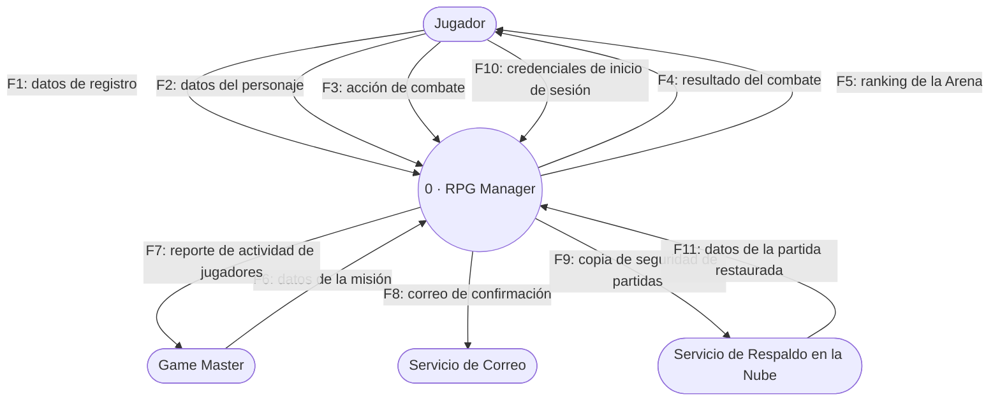
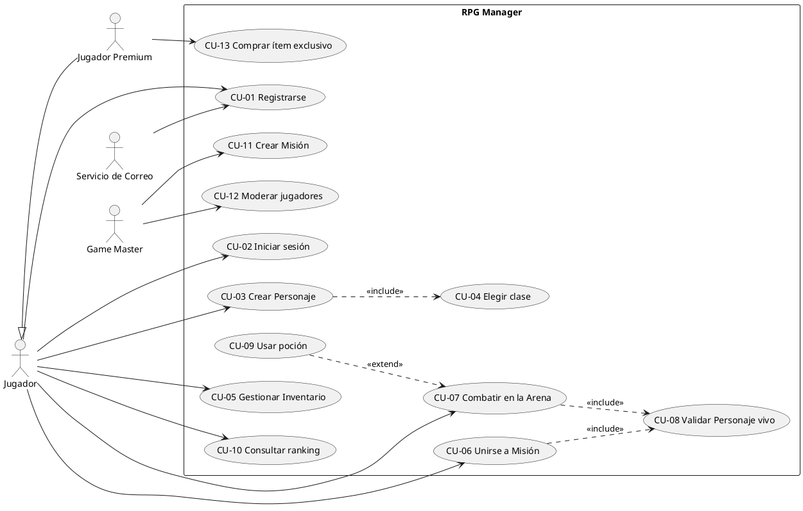
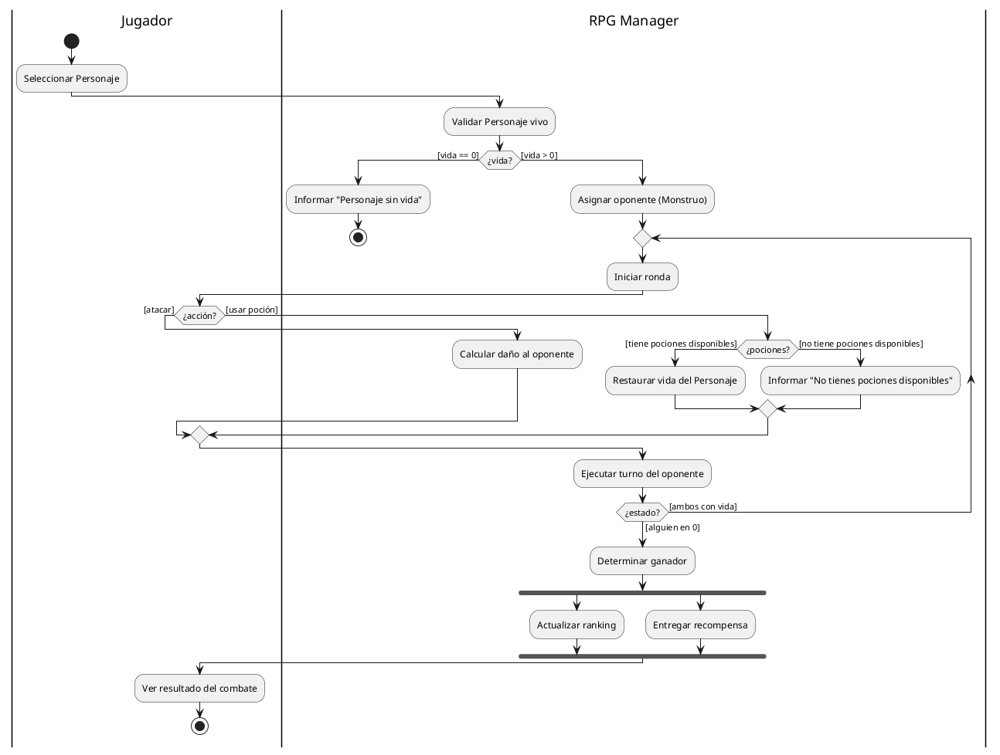
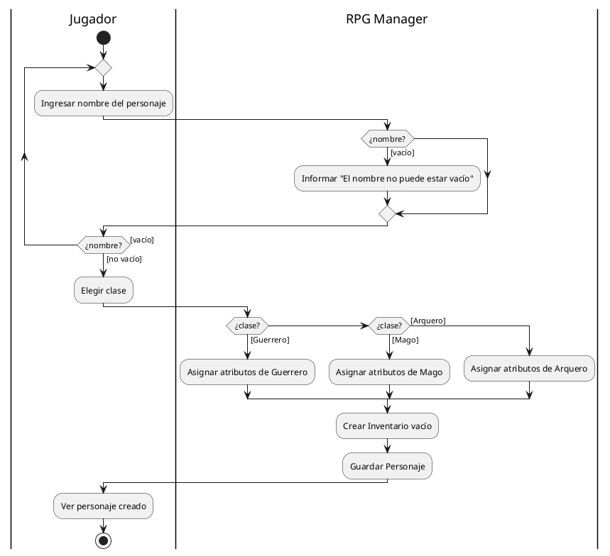

# Taller: Diagramas de Análisis de Sistemas — RPG Manager

**Nombre del estudiante:** Juan Esteban Castellanos Forero
**Código:** 20232578053
**Repositorio:** [github.com/Bandejaa/analisis-de-sistemas](https://github.com/Bandejaa/analisis-de-sistemas)

Respuestas y código de diagramas (DFD de Contexto, Casos de Uso y Actividades) para el proyecto **RPG Manager**.

---

## Bloque 0 · Diagramas (.drawio y .svg)

Los cuatro diagramas se encuentran en `diagramas-drawio/` dentro de este repositorio:

| Archivo | Contenido |
|---------|-----------|
| `diagramas-drawio/01_contexto_rpg.drawio` / `.svg` | Diagrama de contexto (DFD Nivel 0), con F10 y F11 agregados |
| `diagramas-drawio/02_casos_uso_rpg.drawio` / `.svg` | Diagrama de casos de uso, con Jugador Premium / CU-13 agregados |
| `diagramas-drawio/03_actividades_combate.drawio` (página 1) → `03_actividades_cu07.svg` | Diagrama de actividades CU-07, con la decisión de pociones agregada |
| `diagramas-drawio/03_actividades_combate.drawio` (página 2) → `03_actividades_cu03.svg` | Diagrama de actividades CU-03 Crear Personaje |

---

## Bloque 1 · Diagrama de Contexto (DFD Nivel 0)

### Ejercicio 1A — Flujos faltantes

| # | Origen | Flujo de datos | Destino |
|---|--------|-----------------|---------|
| F10 | Jugador | credenciales de inicio de sesión | RPG Manager |
| F11 | Servicio de Respaldo en la Nube | datos de la partida restaurada | RPG Manager |

### Bug a corregir

| Error | Elemento | Por qué es un error |
|-------|----------|----------------------|
| 1 | Rectángulo "Base de datos de Personajes" conectado al círculo | En un diagrama de contexto (nivel 0) **no se muestran almacenes de datos**. La base de datos es un componente interno del sistema; aparecería recién en un DFD de nivel 1 en adelante. Conectarla directamente al proceso 0 como si fuera una entidad externa rompe la regla de "caja negra" del nivel 0. |
| 2 | Flecha de Jugador al círculo etiquetada "Crear Personaje" | Los flujos de datos se nombran con un **sustantivo que describe el dato que viaja** (p. ej. "datos del personaje"), nunca con una acción o verbo. "Crear Personaje" es un caso de uso, no un dato. |
| 3 | Flecha directa de Jugador a Game Master etiquetada "mensaje" | En el diagrama de contexto **nunca puede haber un flujo entre dos entidades externas**: toda comunicación debe pasar por el proceso central (el sistema), porque el diagrama solo modela lo que entra y sale del sistema. Además, "mensaje" es una etiqueta demasiado genérica para ser un dato real. |

### Código Mermaid — Diagrama de contexto completo

---

## Bloque 2 · Diagrama de Casos de Uso

### Ejercicio 2A — Generalización de actores

**¿Hacia dónde apunta el triángulo vacío y por qué?**
Apunta hacia el actor **general** (Jugador). En UML, el triángulo vacío de una generalización siempre señala al elemento padre/superclase, indicando que el otro extremo (Jugador Premium) es una especialización que hereda el comportamiento del general.

**¿Por qué el Jugador Premium no necesita líneas explícitas a CU-01…CU-10?**
Porque la generalización implica **herencia de asociaciones**: al ser un tipo especializado del Jugador, el Jugador Premium ya tiene implícito el acceso a todos los casos de uso del Jugador. Dibujar de nuevo cada línea sería redundante.

### Bug a corregir

| Error | Elemento | Por qué es un error |
|-------|----------|----------------------|
| 1 | Caso de uso llamado "Inventario" | Un caso de uso se nombra con **verbo + sustantivo** (es una meta del actor), no con un sustantivo solo. "Inventario" es un objeto del dominio; el caso de uso correcto es "Gestionar Inventario". |
| 2 | Actor Game Master dibujado dentro del rectángulo del sistema | Los actores siempre van **fuera** del límite del sistema: son entidades externas que interactúan con él, no funcionalidad interna. |
| 3 | «include» de CU-04 Elegir clase hacia CU-03 Crear Personaje | Dirección invertida. «include» siempre va del caso de uso **base** (el que siempre ejecuta el comportamiento) hacia el caso **incluido**. Debe ir de CU-03 → CU-04, no al revés. |
| 4 | Asociación directa entre los actores Jugador y Game Master | No puede existir una línea de asociación directa entre dos actores (salvo una generalización, que es otra relación). Los actores solo se relacionan con el sistema a través de los casos de uso. |

### Código PlantUML — Diagrama de casos de uso completo

---

## Bloque 3 · Diagrama de Actividades

### Ejercicio 3A — ¿Y si se acaban las pociones?

- **Carril:** RPG Manager (es el sistema quien conoce el estado del inventario del jugador).
- **Guarda 1:** `[tiene pociones disponibles]` → va a **"Restaurar vida del Personaje"**.
- **Guarda 2:** `[no tiene pociones disponibles]` → va a **"Informar: no tienes pociones disponibles"**, y el flujo regresa a la decisión `¿acción?` para que el jugador elija de nuevo.

### Ejercicio 3B — CU-03 Crear Personaje

| # | Carril | Elemento | Texto |
|---|--------|----------|-------|
| 1 | Jugador | Inicial | — |
| 2 | Jugador | Acción | Ingresar nombre del personaje |
| 3 | RPG Manager | Decisión | `[nombre vacío]` → 4 \| `[nombre no vacío]` → 5 |
| 4 | RPG Manager | Acción | Informar "El nombre no puede estar vacío" → vuelve a 2 |
| 5 | Jugador | Acción | Elegir clase |
| 6 | RPG Manager | Decisión (3 salidas) | `[Guerrero]` → Asignar atributos de Guerrero \| `[Mago]` → Asignar atributos de Mago \| `[Arquero]` → Asignar atributos de Arquero |
| 7 | RPG Manager | Unión | Junta las tres ramas de clase |
| 8 | RPG Manager | Acción | Crear Inventario vacío |
| 9 | RPG Manager | Acción | Guardar Personaje |
| 10 | Jugador | Acción → Final | Ver personaje creado → nodo final |

**¿Qué caso de uso del Bloque 2 aparece "escondido" en este flujo?**
**CU-04 Elegir clase** — es exactamente el caso de uso que CU-03 incluye («include») según la tabla 2.4; en el diagrama de actividades se ve materializado como el paso 5-6 (elegir y asignar la clase).

### Bug a corregir

| Error | Elemento | Por qué es un error |
|-------|----------|----------------------|
| 1 | Rombo "¿Tiene flechas?" con una sola salida `[sí]` | Toda decisión debe tener **al menos dos salidas que cubran todos los casos posibles** (p. ej. `[sí]` y `[no]`). Con una sola salida no hay bifurcación real: ya no es una decisión. |
| 2 | Fork que abre dos caminos sin barra Join al final | Toda bifurcación en paralelo (fork) debe cerrarse con una barra de **join** que sincronice y espere a que ambos caminos terminen. Dejar cada camino con su propio nodo final rompe la semántica de concurrencia. |
| 3 | "Calcular daño al oponente" en el carril del Jugador | Cada acción va en el carril de quien realmente la ejecuta. Calcular el daño es una regla de negocio que resuelve el sistema (RPG Manager), no el jugador; ponerla en el carril equivocado atribuye mal la responsabilidad. |

### Código PlantUML — CU-07 Combatir en la Arena (con corrección 3A, fork/join y ciclo)

### Código PlantUML — CU-03 Crear Personaje (dos carriles, validación y ramas de clase)

---

## Bloque 5 · Reflexión final

**1. ¿Por qué el diagrama de contexto no muestra la base de datos del RPG Manager si el sistema sí la usa?**
Porque el diagrama de contexto representa el sistema completo como una sola caja negra: solo muestra las entidades externas y los datos que entran o salen. La base de datos es un elemento **interno** del sistema (un almacén de datos), y el nivel de abstracción del contexto no detalla el funcionamiento interno — eso corresponde a los DFD de nivel 1 en adelante.

**2. ¿Cuál es la diferencia entre el flujo de datos "datos del personaje" y el caso de uso "Crear Personaje"?**
"Datos del personaje" es un sustantivo que describe **qué información viaja** entre el Jugador y el sistema (nombre, clase, etc.). "Crear Personaje" es un caso de uso: una **meta completa** que el actor logra con el sistema, que internamente implica recibir esos datos, validarlos y guardarlos. El flujo de datos es el "qué viaja"; el caso de uso es el "qué se logra".

**3. Ejemplo propio de «include» y «extend» no citados en el taller**
- **«include»:** CU-01 Registrarse podría incluir "Verificar disponibilidad de nombre de usuario", porque esa verificación ocurre **siempre** que alguien se registra, sin excepción.
- **«extend»:** CU-07 Combatir en la Arena podría extenderse con "Activar habilidad especial", porque activarla es **opcional**: el jugador puede decidir usarla o no durante un combate dado.

**4. ¿Qué información aporta el diagrama de actividades que el de casos de uso no puede mostrar?**
El diagrama de actividades muestra el **orden y la lógica interna** de cómo se ejecuta un caso de uso: la secuencia de pasos, las decisiones con sus condiciones (guardas), los ciclos, el paralelismo (fork/join) y quién es responsable de cada acción (carriles). El diagrama de casos de uso solo indica *qué* puede hacer cada actor, no *cómo* ni en qué orden ocurre internamente.

**5. "Calcular daño al oponente" como método en POO: ¿en qué clase vive?**
Probablemente en una clase **ArenaDeCombate** (o Combate), porque el cálculo de daño depende de la interacción entre dos combatientes y de las reglas propias del enfrentamiento (tipo de ataque, defensa, etc.), no solo de los atributos de un personaje aislado. Mantenerlo ahí respeta el principio de responsabilidad única: la clase Personaje no necesita conocer las reglas completas del combate.

**6. ¿Cuándo preferirías PlantUML y cuándo draw.io en un proyecto real?**
PlantUML conviene cuando el diagrama **cambia seguido y se versiona en Git**, porque al ser texto plano los cambios se revisan línea a línea en un diff y se integra fácil en documentación automática. draw.io conviene cuando se necesita **control visual total** (posición, color, detalle) para presentar o explicar a una audiencia no técnica, o cuando el diagrama es muy elaborado visualmente y no cambiará con tanta frecuencia.

---
